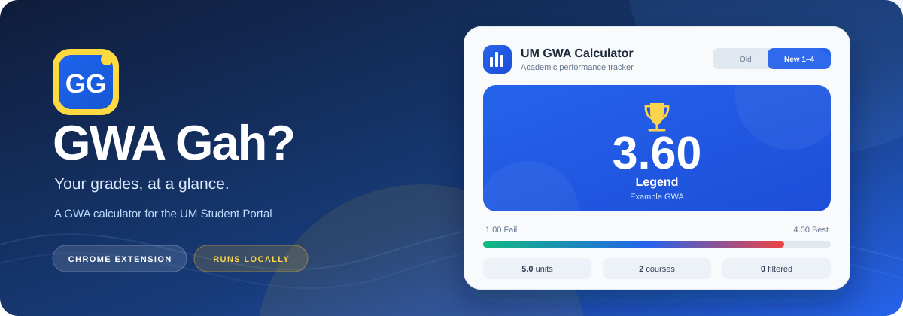
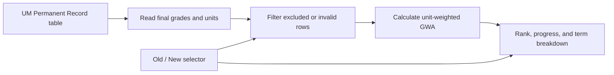

<p align="center">
  
</p>

<h1 align="center">GWA Gah?</h1>

<p align="center">A Chrome extension that calculates your general weighted average (GWA) from your University of Mindanao Permanent Record and shows your progress in a game-inspired dashboard.</p>

<p align="center"><code>Version 2.1.0</code> &nbsp; <code>Chrome · Manifest V3</code> &nbsp; <code>Vanilla JavaScript</code> &nbsp; <code>Runs locally</code></p>

<p align="center">
  <a href="#at-a-glance"><strong>At a glance</strong></a> &nbsp;·&nbsp;
  <a href="#app-tour"><strong>App tour</strong></a> &nbsp;·&nbsp;
  <a href="#how-it-works"><strong>How it works</strong></a> &nbsp;·&nbsp;
  <a href="#install-in-chrome"><strong>Install</strong></a> &nbsp;·&nbsp;
  <a href="#troubleshooting"><strong>Troubleshooting</strong></a>
</p>

GWA Gah? adds a calculator above the grades on the [UM Student Portal Permanent Record](https://student.umindanao.edu.ph/student/spr). It reads the grades already displayed on that page, excludes specified courses and invalid entries, then calculates a unit-weighted average. **The result is a personal estimate, not an official UM record or a determination of academic honors.**

## At a glance

<table>
  <tr>
    <td align="center" width="25%"><strong>01 · Calculate</strong><br><sub>Unit-weighted GWA from final grades</sub></td>
    <td align="center" width="25%"><strong>02 · Compare</strong><br><sub>Old and new grading system selector</sub></td>
    <td align="center" width="25%"><strong>03 · Explore</strong><br><sub>Rank, progress, and semester breakdown</sub></td>
    <td align="center" width="25%"><strong>04 · Copy</strong><br><sub>One-click GWA copy and manual refresh</sub></td>
  </tr>
</table>

The extension runs on the Permanent Record page only. It has no separate backend service, sign-in, analytics, or grade upload.

## App tour

The banner above is an **illustration with example values**, styled after the actual extension: a blue and gold icon, rounded white card, blue rank panel, and progress bar. Your own GWA and course counts come from your Permanent Record.

| In the calculator | What it shows |
| --- | --- |
| **Old / New toggle** | Switches between 1.0–5.0 (old, lower is better) and 1.0–4.0 (new, higher is better). The new system is selected initially; your choice is remembered in the portal's local storage. |
| **Rank and progress** | A game-inspired rank from Legend to Struggling, based on the calculated GWA. The progress bar follows the selected scale. |
| **Units, Courses, Filtered** | Totals for included units and courses, plus a count of excluded rows. |
| **Grade Reference** | An expandable lookup table for the selected grading system. |
| **Semester breakdown** | GWA, course count, and units for each term found in the record, plus reasons for excluded entries. |
| **Copy GWA / Recalculate** | Copies the two-decimal GWA or rereads the current record. |

Rank titles and descriptions are motivational labels inside the extension. They do not certify official distinctions or honors.

## How it works



The extension uses the **numeric Final Grade** shown in the portal. It does not convert raw scores before calculating. For each included course:

```text
GWA = Σ(final grade × units) ÷ Σ(units)
```

For example, a 4.0 grade in a 3-unit course and a 3.0 grade in a 2-unit course give `(4.0 × 3 + 3.0 × 2) ÷ 5 = 3.60`. The displayed GWA is rounded to two decimal places; rank thresholds use the unrounded result.

The calculator filters out:

- Course codes such as **NSTP 1**, **PE 1**, and **PAHF 1**, plus **CAED 500** (including `CAED 500/L`).
- Rows without a numeric final grade, with a grade outside the selected system's 1.0–5.0 or 1.0–4.0 range, or without positive units.

Filtered rows are highlighted in the portal table and listed with their reason under **Semester breakdown**. The extension only recognizes a Permanent Record table with **Course Number**, **Descriptive Title**, **Final Grade**, and **Unit** columns.

## Install in Chrome

1. Download this repository with **Code → Download ZIP**, then extract it. If you cloned it with Git, use your cloned folder instead.
2. Open `chrome://extensions` in Chrome and turn on **Developer mode**.
3. Click **Load unpacked** and select the extracted folder that contains [`manifest.json`](manifest.json). The folder name may vary.
4. Open the [UM Student Portal Permanent Record](https://student.umindanao.edu.ph/student/spr) and sign in. The calculator appears above the record table when its grades load.

After pulling or downloading an update, return to `chrome://extensions` and click the extension's **Reload** button, then refresh the Permanent Record page.

## Grading systems and ranks

Select the system that applies to your record. The grade reference in the calculator helps you inspect the scale, while the actual GWA calculation uses the portal's Final Grade values.

| Rank | New system: higher is better | Old system: lower is better |
| --- | --- | --- |
| 🏆 Legend | GWA ≥ 3.50 | GWA ≤ 1.50 |
| ⭐ Master | 3.00 ≤ GWA < 3.50 | 1.50 < GWA ≤ 2.00 |
| 🎯 Scholar | 2.50 ≤ GWA < 3.00 | 2.00 < GWA ≤ 2.50 |
| 📘 Achiever | 2.00 ≤ GWA < 2.50 | 2.50 < GWA ≤ 3.00 |
| 🎮 Player | 1.50 ≤ GWA < 2.00 | 3.00 < GWA ≤ 3.50 |
| ⚡ Rookie | 1.00 < GWA < 1.50 | 3.50 < GWA ≤ 4.00 |
| 🔥 Struggling | GWA = 1.00 | 4.00 < GWA ≤ 5.00 |

## Explore the repository

| File | Purpose |
| --- | --- |
| [`manifest.json`](manifest.json) | Chrome Manifest V3 settings and Permanent Record URL match |
| [`content.js`](content.js) | Reads the record, calculates the GWA, and builds the dashboard |
| [`styles.css`](styles.css) | Calculator layout, colors, ranks, and responsive styles |
| [`icons/`](icons/) | Blue and gold GG extension icons |
| [`docs/readme-banner.svg`](docs/readme-banner.svg) | Illustrated README banner |

## Troubleshooting

| Problem | What to check |
| --- | --- |
| Calculator does not appear | Open the Permanent Record at `/student/spr`, wait for the grades table, and refresh the page. Check that the extension is enabled in `chrome://extensions`. |
| “No valid courses found” | Confirm the selected grading system matches your record and that at least one course has a numeric final grade and positive units. Open **Semester breakdown** for filtered entries. |
| GWA differs from your expectation | Check the selected system, excluded courses, and unit values. The extension reads the portal's Final Grade values; it does not use raw scores or unposted grades. |
| Copy GWA fails | Use **Recalculate** and try again. You can also select and copy the displayed number manually. |

If the portal changes its table headings or layout, the calculator may need an update.

## Privacy and scope

The manifest injects the extension only on `https://student.umindanao.edu.ph/student/spr*`. The code reads the page's grades locally and does not send them to a server. It saves only your old/new grading system choice in that site's `localStorage`; it does not save a copy of your grades. Review [`manifest.json`](manifest.json) and [`content.js`](content.js) if you want to inspect exactly what runs.

## Contributing

Found a calculation issue, an excluded course that needs review, or a portal change? [Open an issue](https://github.com/Feliciety02/UM-GWA-Calculator-Extension/issues) with the steps to reproduce it. If you include a screenshot, hide your name, student ID, and grades first. Pull requests are welcome.

Made by [Fe Anne Malasarte](https://github.com/Feliciety02), BS Computer Science at the University of Mindanao.
